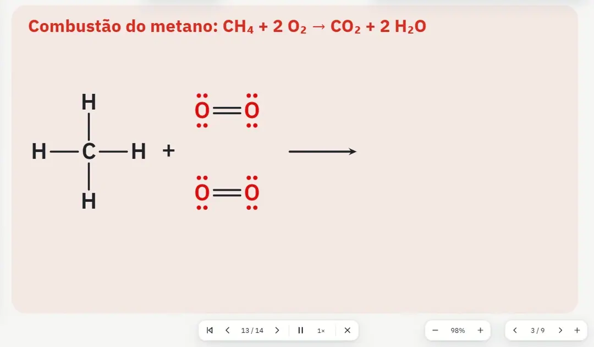

<p align="center"></p>

<h1 align="center">ChemBoard</h1>

<p align="center"><strong>Draw chemistry live. Present it one step at a time.</strong></p>

<p align="center">
  <a href="https://henriquecsj.github.io/chemboard/"><strong>Open ChemBoard ↗</strong></a> ·
  <a href="#teaching-examples">Sample lectures</a> ·
  <a href="docs/README.pt-BR.md">Português</a>
</p>

ChemBoard is a browser whiteboard for chemistry instructors. Draw Lewis structures as you explain them, open 3D models to discuss geometry, and guide the class through saved panels. No account or installation is required.

<picture>
  <source media="(prefers-reduced-motion: reduce)" srcset="docs/media/reaction-playback-poster.webp">
  
</picture>

*One step in the methane combustion panel. The original reactants fade as the products form. [Play the recording with controls](https://henriquecsj.github.io/chemboard/docs/media/reaction-playback.mp4).*

## Put a structure on the board

1. [Open ChemBoard](https://henriquecsj.github.io/chemboard/), choose **English** or **Português (Brasil)**, and start with an empty board.
2. Press **L** to switch to the Lewis pen. Choose **O** in the element strip and click the board to place oxygen.
3. Choose **H** and drag twice from oxygen to add the two O–H bonds. Click in two separate spots beside oxygen to add its lone pairs.

<picture>
  <source media="(prefers-reduced-motion: reduce)" srcset="docs/media/lewis-pen-poster.webp">
  
</picture>

*Building water directly on the board. [Play the recording with controls](https://henriquecsj.github.io/chemboard/docs/media/lewis-pen.mp4).*

## Connect a structure to its geometry

Press **K** to open **Templates and Lewis generator**, choose **CH₄**, and insert it into the board. With the molecule selected, press **D** to open the 3D VSEPR model. Rotate the model, compare ball-and-stick with space filling, or use the measurement controls to examine bond angles.


Press **W** to open **Atomic orbitals**. Change the quantum numbers and compare the surface, cloud, 2D cut, and radial views. The **Nodes** and **Axes** controls help orient the class before you insert a view on the board.


## Teaching examples

Open **Menu → Ready-made lectures** (**Aulas prontas**) and insert a lecture after the current page. Each lecture is editable and its teaching material is in Portuguese.

| Lecture | A place to start | Editable board |
| --- | --- | --- |
| **Animations: examples** · 8 pages | Open the reaction page, double-click the methane combustion panel with the Hand tool, then press **→** to begin. Advance through the reactants and products. Later pages build MO diagrams and animate orbital overlap and curved-arrow mechanisms. | [Download JSON](https://henriquecsj.github.io/chemboard/examples/animation-examples.json) · [Reaction page overview](docs/images/reaction-lesson.png) |
| **Intermolecular interactions** · 9 pages | Start with the moving solid, liquid, and gas models. Advance to compare ion–dipole, dipole–dipole, induced-dipole, London dispersion, and hydrogen-bonding examples. | [Download JSON](https://henriquecsj.github.io/chemboard/examples/intermolecular-interactions.json) |


To use a downloaded copy, save the JSON locally and choose **Menu → Open board** (**Abrir quadro**). ChemBoard asks whether to add the pages or replace the current board when it already contains work.

## Prepare a board for class

| Task | In ChemBoard |
| --- | --- |
| Build a sequence | Add pages with **+** beside the page counter. Zoom to a panel, right-click an empty part of the board, and choose **Save this view as a stop**. |
| Present | Use **→ / ←** to navigate saved views and reveals. Use the step toolbar to restart, pause, or change speed. Press **Esc** to return to the full board. |
| Direct attention | Press **F** for full screen, **U** to hide the controls, **X** for the laser pointer, or **O** for the spotlight. |
| Protect a finished drawing | Right-click an object and choose **Lock**, or use the lock icon on a selection. Right-click a locked object and choose **Unlock** when you need to edit it. |
| Share the lesson | **Save board (.json)** keeps an editable multi-page copy. **Export image (PNG)** creates an image of the current page for a handout or slide. |

## Run locally

Open [`index.html`](index.html) from a downloaded copy of the repository, or serve the checkout over HTTP:

```sh
git clone https://github.com/HenriqueCSJ/chemboard.git
cd chemboard
python -m http.server 8000 --bind 127.0.0.1
```

Then visit [localhost:8000](http://127.0.0.1:8000/). ChemBoard is a static HTML, CSS, and JavaScript app. Drawing and the built-in lectures work from the local HTML without a connection. Online molecule lookup, remote media, and web fonts use the network. The 3D tools require WebGL.

The current board autosaves in the browser under the address where it was opened. Use JSON to make a backup, move between computers, or switch between the hosted and local versions.

## Report a problem or contribute

Include the browser and version, the board or lecture page, and the exact action that led to the problem. A shareable JSON board or a short screen recording can make an intermittent issue reproducible. [Open an issue](https://github.com/HenriqueCSJ/chemboard/issues/new)

The app entry point is [`index.html`](index.html). The [example boards](examples/) can be used to check import, lecture navigation, and scripted playback. GitHub Pages deploys the root of `main` directly, with no build step.

## License

[Apache 2.0](LICENSE). The [bundled Three.js](https://github.com/mrdoob/three.js) is MIT-licensed, with its notice included in `index.html`.
