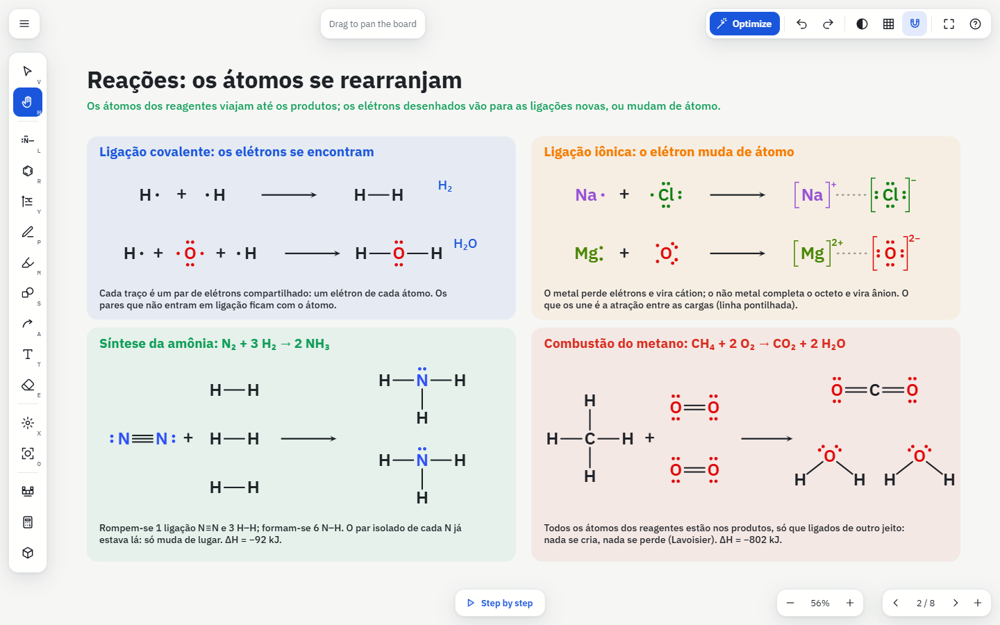
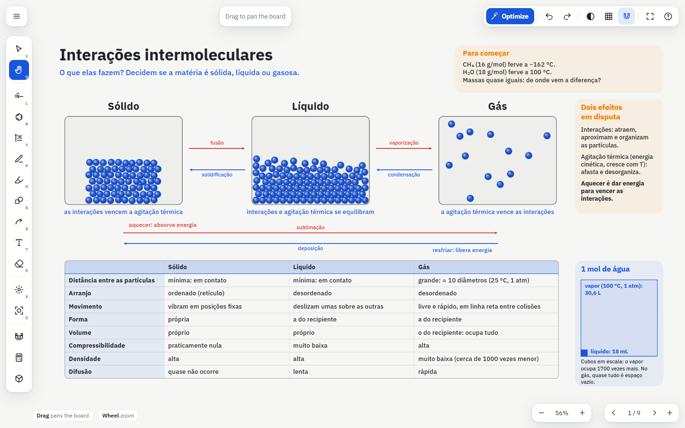

# ChemBoard

**An interactive whiteboard for teaching chemistry.**

Draw a Lewis structure in front of the class, then use the same board to show where electrons go or how a reaction rearranges atoms. Build a lecture around saved views and advance through them at your own pace.

**[Open ChemBoard →](https://henriquecsj.github.io/chemboard/)** · [Try a sample lecture](#try-a-lecture) · [Report a bug](https://github.com/HenriqueCSJ/chemboard/issues/new)

The interface is available in English and Brazilian Portuguese. It runs in the browser without an account or installation.



*The reaction page in the Animations: examples lecture. Each panel can be presented on its own.*

## Try a lecture

1. Open ChemBoard and choose **English** or **Português (Brasil)**.
2. Open **Menu → Ready-made lectures** (**Aulas prontas** in Portuguese) and insert **Animations: examples** or **Intermolecular interactions**.
3. Use **→** and **←** to move between saved views. On pages with scripted reveals, click **Step by step** to start, then use the same arrows to advance or replay the explanation. The playback toolbar lets you pause and change the speed.
4. Press **F** for full screen. When you're ready to edit again, press **Esc** to exit step-by-step mode.

Both lectures below are in Portuguese. They are built into the app. The downloadable copies also open through **Menu → Open board**.

| Lecture | What to look for | Board file |
| --- | --- | --- |
| **Animations: examples** · 8 pages | Follow atoms from reactants to products. Assemble molecular orbital diagrams and explore orbital overlap, crystal-field splitting, and electron-pushing mechanisms. | [Animation examples JSON](examples/animation-examples.json?raw=1) |
| **Intermolecular interactions** · 9 pages | Compare solid, liquid, and gas particle models, then work through ion–dipole interactions, London dispersion, hydrogen bonding, and the other examples. | [Intermolecular interactions JSON](examples/intermolecular-interactions.json?raw=1) |

<details>
<summary>Preview the intermolecular interactions lecture</summary>



</details>

## Build your own board

- **Draw structures.** Press **L** for the Lewis pen. Choose an element and click to place an atom. Drag between atoms to bond them, or click beside an atom to add lone pairs. Use **D** to open a selected molecule in 3D.
- **Explain a change.** Add curved electron arrows, build a molecular orbital diagram, or plot a curve with a parameter you can vary during class.
- **Prepare the presentation.** Add a page with the **+** beside the page counter. Right-click the board and choose **Save this view as a stop** to return to a particular region with the arrow keys. Use the laser pointer or spotlight to direct attention.
- **Protect a completed drawing.** Right-click an object and choose **Lock**, or use the lock icon after selecting several objects. Right-click the locked object and choose **Unlock** to edit it again. Locking a bond also holds its atoms in place.
- **Keep a copy.** Use **Menu → Save board (.json)** for an editable file or **Export image (PNG)** for a handout. Browser autosave keeps the current board on this device and site, so use JSON to move it to another computer.

## Run locally

Download or clone this repository and open [`index.html`](index.html) in a desktop browser. You can also serve the repository root with Python:

```sh
python -m http.server 8000 --bind 127.0.0.1
```

Open [http://127.0.0.1:8000](http://127.0.0.1:8000/). Drawing and the built-in lectures work offline from the local HTML. Online molecule lookup, remote media, and web fonts use the network. WebGL is required for 3D.

## Contribute

If a panel, animation, or saved board behaves unexpectedly, include the browser and version, the lecture and page, and the exact action you took. Attach a small shareable board file or a screen recording when it helps reproduce the issue. [Open an issue](https://github.com/HenriqueCSJ/chemboard/issues/new)

The app is maintained in `index.html` and served from the root of `main` with GitHub Pages. There is no build step. The two boards in [`examples/`](examples/) are useful for checking import and presentation changes.

## License

ChemBoard is licensed under [Apache 2.0](LICENSE). The bundled [Three.js](https://github.com/mrdoob/three.js) code is MIT-licensed. Its license text is included in `index.html`.
