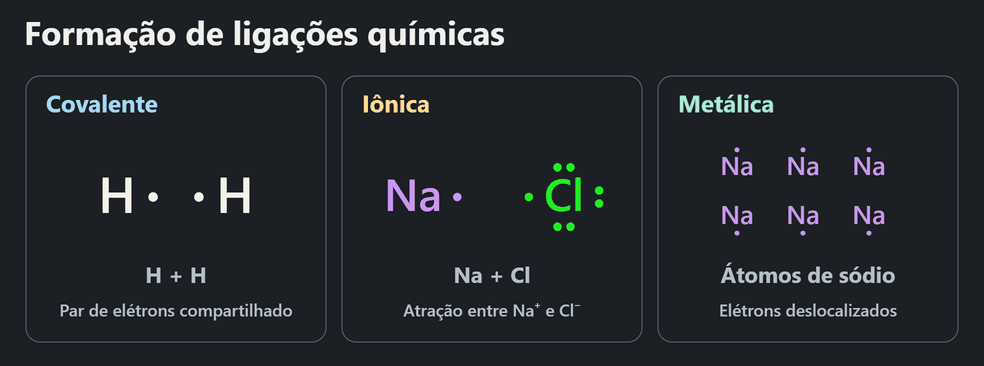

<p align="center"></p>

<h1 align="center">ChemBoard</h1>

<p align="center"><strong>Draw chemistry live. Present it one step at a time.</strong></p>

<p align="center">
  <a href="https://henriquecsj.github.io/chemboard/"><strong>Open ChemBoard ↗</strong></a> ·
  <a href="#teaching-examples">Sample lectures</a> ·
  <a href="#ic677-lectures">IC677</a> ·
  <a href="docs/README.pt-BR.md">Português</a>
</p>

ChemBoard is a browser whiteboard for chemistry instructors. Draw Lewis structures as you explain them, open 3D models to discuss geometry, and guide the class through saved panels. No account or installation is required.

<picture>
  <source media="(prefers-reduced-motion: reduce)" srcset="docs/media/reaction-playback-poster.webp">
  
</picture>

*One step in the methane combustion panel. The original reactants fade as the products form. [Play the recording with controls](https://henriquecsj.github.io/chemboard/docs/media/reaction-playback.mp4).*

## Put a structure on the board

1. [Open ChemBoard](https://henriquecsj.github.io/chemboard/), choose **English** or **Português (Brasil)**, and start with an empty board.
2. Press **L** to switch to the Lewis pen. Choose **O** in the element strip and click the board to place oxygen.
3. Choose **H** and drag twice from oxygen to add the two O–H bonds. Click in two separate spots beside oxygen to add its lone pairs.

<picture>
  <source media="(prefers-reduced-motion: reduce)" srcset="docs/media/lewis-pen-poster.webp">
  
</picture>

*Building water directly on the board. [Play the recording with controls](https://henriquecsj.github.io/chemboard/docs/media/lewis-pen.mp4).*

With **Select** or the **Lewis pen**, drag a formal or partial charge label to reposition it. The label follows its atom when you move or rotate the structure. Double-click the label to restore automatic placement.

Drag a lone pair with **Select** to move it around its atom. With the **Lewis pen**, hold **Shift** before you start dragging the pair to move it without a chemistry action. Use **Undo** to reverse the placement.

## Show how bonds form

<picture>
  <source media="(prefers-reduced-motion: reduce)" srcset="docs/media/bond-formation-poster.png">
  
</picture>

*H₂ shows a shared electron pair. Electron transfer produces Na⁺ and Cl⁻, which attract each other. In solid sodium, valence electrons are delocalized among the cations.*

## Draw carbon chains and add hydrogens

- Press **Z** and drag on the board. The zigzag preview shows the carbon count before you release. Hold **Shift** to snap the direction in 15° steps. Drag from a carbon with an available valence to extend the structure, or choose **Insert by count…** for a chain of 2–80 carbons. New chains use skeletal notation by default.
- Click **Complete H** to add the missing hydrogens to the selection while preserving bond orders. The new chain is selected after drawing. Double-click an atom or bond with **Select** to select an existing molecule.
- To illustrate hydrogenation, select a C=C or C≡C bond or both of its carbons and click **Hydrogenate C=C/C≡C**. The tool reduces eligible non-aromatic bonds to single bonds and completes the hydrogens on their carbons. A single **Undo** reverses the edit.

## Draw and rotate on the board

- **Rotate.** Select one atom to rotate its whole molecule. You can also rotate drawings, text, images and videos, individually or as a selection. Use **−90°**, **+90°**, or **Rotate…** for an exact angle. Drag the round handle for 1° steps and hold **Shift** to snap to 15°. Press **Esc** to cancel the drag.
- **Freehand.** Open the **Pen** and enable **Smooth** to reduce wobble. Under **Shapes**, choose **Hold** and pause briefly at the end of a stroke, or choose **Auto** to convert recognized shapes on release. Choose **Off** for unrestricted ink.
- **Preset shapes.** Press **S**, choose a shape and hold **Shift** while dragging for a circle, square or equilateral triangle. The **Constrain proportions** toggle offers the same control on a touchscreen.

## Compare elements on the board

Open the periodic table with **Tab**, choose **EN**, **Radius**, or **IE**, and mark the elements you want. **Only the selection on board** places those cells with the chosen values. The full-table insertion also carries the values. A dash marks unavailable data.

Right-click any cell on the board to highlight it or separate it from a crop as a movable tile. From a full table, the same option copies the cell. On a touchscreen, select the table and open **Table elements…** to make these edits or switch the displayed property.

## Connect a structure to its geometry

Press **K** to open **Templates and Lewis generator**, choose **CH₄**, and insert it into the board. With the molecule selected, press **D** to open the 3D VSEPR model. Rotate the model, compare ball-and-stick with space filling, or use the measurement controls to examine bond angles.

Select **Insert live 3D model** to place a rotatable object on the board. Drag it with the Hand tool to orbit it during class. You can name the model in a page script and apply a symmetry operation in a cue. [3D scripting examples](docs/scenes.md#spatial-drawings-and-matrices)


Press **W** to open **Atomic orbitals**. Change the quantum numbers and compare the surface, cloud, 2D cut, and radial views. The **Nodes** and **Axes** controls help orient the class before you insert a view on the board.


## Build a molecular orbital diagram

Press **Y**, click open space to start a diagram, and choose degeneracy and type under **Next level**. Click a column to place the level. To change a level already on the board, double-click it or select it and choose **Edit level**.

The level, column, gap, and axis labels accept inline math such as `$\frac{\Delta_o}{2}$` alongside text. The label editor previews the result and has buttons for bold, italic, underline, fractions, and roots.

## Write and format board text

Press **T** and click where the text should go. The editor previews multiline text, chemistry notation such as H₂O, and inline LaTeX such as `$\frac{\Delta E}{RT}$`. Select a passage to apply bold, italic, underline, or scripts. Choose **Equation mode** to write an entire block in math notation.

Use **Apply** or **Ctrl/⌘ + Enter** to keep your edit. Clicking the board also applies it. Press **Esc** or choose **Cancel** to discard the edit.

## Connect an AI assistant

Press **J** to open the assistant. The local companion works with ChatGPT through Secure MCP Tunnel and with local MCP clients such as Claude Desktop, Claude Code and Codex. To draw from inside the board, configure an OpenAI, Anthropic, or compatible API such as Gemini or Ollama. [Connector setup](connectors/README.md)

## Teaching examples

Open **Menu → Ready-made lectures** (**Aulas prontas**) and insert a lecture after the current page. Expand **Related activities** within a lecture to insert a shorter activity or a set of exercises. All teaching material is editable and in Portuguese.

| Lecture | A place to start | Editable board |
| --- | --- | --- |
| **Animations: examples** · 8 pages | Open the reaction page, double-click the methane combustion panel with the Hand tool, then press **→** to begin. Advance through the reactants and products. Later pages build MO diagrams and animate orbital overlap and curved-arrow mechanisms. | [Download JSON](https://henriquecsj.github.io/chemboard/examples/animation-examples.json) · [Reaction page overview](docs/images/reaction-lesson.png) |
| **Intermolecular interactions** · 9 pages | Start with the moving solid, liquid, and gas models. Advance to compare ion–dipole, dipole–dipole, induced-dipole, London dispersion, and hydrogen-bonding examples. | [Download JSON](https://henriquecsj.github.io/chemboard/examples/intermolecular-interactions.json) |
| **O risco a lápis · Bohr–Rydberg** · 7 scenes | Ask why 550 nm sits between two Balmer lines. The spectrum, pencil mark, and energy caliper carry across scenes. The related activity adds a draggable Balmer graph and worked problems on photon energy and copper deposition. | [Scene source](examples/bohr-rydberg.chemboard) · **Ready-made lectures** |
| **Cenas: exemplos** · 5 pages | Watch Arrhenius equations transform, trace a Lewis acid–base reaction, and vary a Maxwell–Boltzmann graph whose labels update live. | [Download JSON](examples/scene-examples.json) · **Ready-made lectures** |


To use a downloaded copy, save the JSON locally and choose **Menu → Open board** (**Abrir quadro**). ChemBoard asks whether to add the pages or replace the current board when it already contains work.

### IC677 lectures

Open **Menu → Ready-made lectures** to insert an editable copy. When presenting the full molecular symmetry course, **Menu → Lecture chapters…** jumps to a topic. Use **Page Down** and **Page Up** to step through the cues. The Hand tool lets you rotate the 3D structures and lattices.

| Lecture | What it covers | Files |
| --- | --- | --- |
| **Molecular symmetry** · 48 scenes, 225 cues | Start with symmetry elements and point groups, then move through matrices and character tables to spectroscopy and vibrational modes. The related activity works through the symmetry matrices for water. | [Board JSON](https://henriquecsj.github.io/chemboard/examples/ic677-simetria-molecular.json) · [Scene source](examples/ic677-simetria-molecular.chemboard) · [Water activity source](examples/ic677-simetria-agua.chemboard) |
| **Solid state** · 15 scenes, 71 cues | Build unit cells from repeating patterns, compare the Bravais lattices, and explore packing, voids and crystal structures. The related activity compares the three cubic cells side by side. | [Board JSON](https://henriquecsj.github.io/chemboard/examples/ic677-estado-solido.json) · [Scene source](examples/ic677-estado-solido.chemboard) · [Cubic cells activity source](examples/ic677-celulas-cubicas.chemboard) |

Open a board JSON in **Menu → Open board…**. To read or edit a standalone `.chemboard` file, choose **Menu → Animation script… → Open file…**.

## Prepare a board for class

| Task | In ChemBoard |
| --- | --- |
| Build a sequence | Add pages with **+** beside the page counter. Zoom to a panel, right-click an empty part of the board, and choose **Save this view as a stop**. |
| Present | Use **→ / ←** to navigate saved views and reveals. Use the step toolbar to restart, pause, or change speed. Press **Esc** to return to the full board. |
| Direct attention | Press **F** for full screen, **U** to hide the controls, **X** for the laser pointer, or **O** for the spotlight. |
| Protect a finished drawing | Right-click an object and choose **Lock**, or use the lock icon on a selection. Right-click a locked object and choose **Unlock** when you need to edit it. |
| Share the lesson | **Save board (.json)** keeps the pages, cues, and animations in one file. **Include editable scripts** also saves the source text. **Export image (PNG)** captures the current page. |

To animate a formula or a shape in a teaching step, select its initial and final poses in that order. Right-click either object and choose **Move between steps…**. For formulas, click the starting term and its corresponding term in the two previews. Press **→** or **Page Down** to advance to the chosen step while presenting.

While presenting, use Pen or Highlighter to annotate the current cue. The marks stay with that cue for the session. The step toolbar clears them, and **Ctrl+Z** undoes the last annotation on the current cue.

### Write a page script

Open **Menu → Page script…** to author a single page in English or Portuguese. Name an existing drawing from its context menu to animate it in the script. You can place objects relative to one another, trace or morph shapes and equations, count numbers, and bind displayed values to live chart sliders. **Apply** edits the page and **Undo** restores its script, objects, and frame. [Page script reference](docs/scenes.md)

### Write a scene

Open **Menu → Animation script…** on any board. A Portuguese-language script can define the entire lesson, including the background, text, editable LaTeX, and diagrams. Each `cena` creates a 2400 × 1350 page, with (0, 0) at the top left. Declare its objects first. Each `passo` waits for **→** or **Page Down**. Use **←** or **Page Up** to go back. Commands within a step run together, and `depois` delays a single animation in milliseconds.

```text
cena "Photon energy" fundo #101c30
texto title 140 140 88 #f5f7fc "Photon energy" negrito
formula energy 140 420 110 #f5f7fc "E=h\\nu" oculto
linha underline 140 650 950 650 8 #ff847d oculto

passo "Show the relation"
  mostrar energy
  traçar underline 950
```

Use `linha`, `seta`, `retangulo`, `circulo`, or `caminho` to draw diagrams. Quote text and LaTeX as JSON strings, doubling each LaTeX backslash. The optional `oculto` flag starts an object hidden. `mostrar` and `ocultar` control visibility. `traçar` draws a stroke over time. `mover`, `girar`, and `transformar` animate compatible objects. Paths with the same point count can morph point by point and change stroke color. In formula poses, matching `\\term{id}{…}` groups carry their identity between expressions.

To carry an object between pages, give it the same name in both scenes and add `transicao 1600 axis marker` to the destination scene before its first `passo`. Each named object needs a visible closing pose in the preceding scene and a visible opening pose in the destination. The next click moves those poses over 1600 ms. The previous key reverses the handoff. Use compatible shapes, matching point counts for paths, identical labels for plain text, or matched LaTeX formulas.

Add `roteiro pagina` immediately after a `cena` line to use English or Portuguese page-script effects within that scene. A cue can morph a circle and count a value in parallel, and the following scene can carry the transformed shape to a new location. [Combined example](docs/scenes.md#combine-page-scripts-and-scene-transitions)

**Open file…** loads a script and **Compile into new pages** inserts an editable rehearsal copy after the current page. **Save script** saves the text as a `.chemboard` file. Open [the Bohr–Rydberg source](examples/bohr-rydberg.chemboard) for a multi-scene example. To script shapes already on the board, select a shape before opening the editor.

## Run locally

Open [`index.html`](index.html) from a downloaded copy of the repository, or serve the checkout over HTTP:

```sh
git clone https://github.com/HenriqueCSJ/chemboard.git
cd chemboard
python -m http.server 8000 --bind 127.0.0.1
```

Then visit [localhost:8000](http://127.0.0.1:8000/). ChemBoard is a static HTML, CSS, and JavaScript app. Drawing and the built-in lectures work from the local HTML without a connection. Online molecule lookup, remote media, and web fonts use the network. The spatial lecture renderer uses WebGL when available and provides a Canvas fallback.

The current board autosaves in the browser under the address where it was opened. Use JSON to make a backup, move between computers, or switch between the hosted and local versions.

## Report a problem or contribute

Include the browser and version, the board or lecture page, and the exact action that led to the problem. A shareable JSON board or a short screen recording can make an intermittent issue reproducible. [Open an issue](https://github.com/HenriqueCSJ/chemboard/issues/new)

The app entry point is [`index.html`](index.html). The [example boards](examples/) can be used to check import, lecture navigation, and scripted playback. GitHub Pages deploys the root of `main` directly, with no build step.

The Pages check runs after each push to `main` and daily. It compares the public homepage, lesson downloads and media with the current branch, allowing time for deployment to propagate. [Pages verification runs](https://github.com/HenriqueCSJ/chemboard/actions/workflows/verify-pages.yml)

## License

[Apache 2.0](LICENSE). The [bundled Three.js](https://github.com/mrdoob/three.js) is MIT-licensed, with its notice included in `index.html`.
