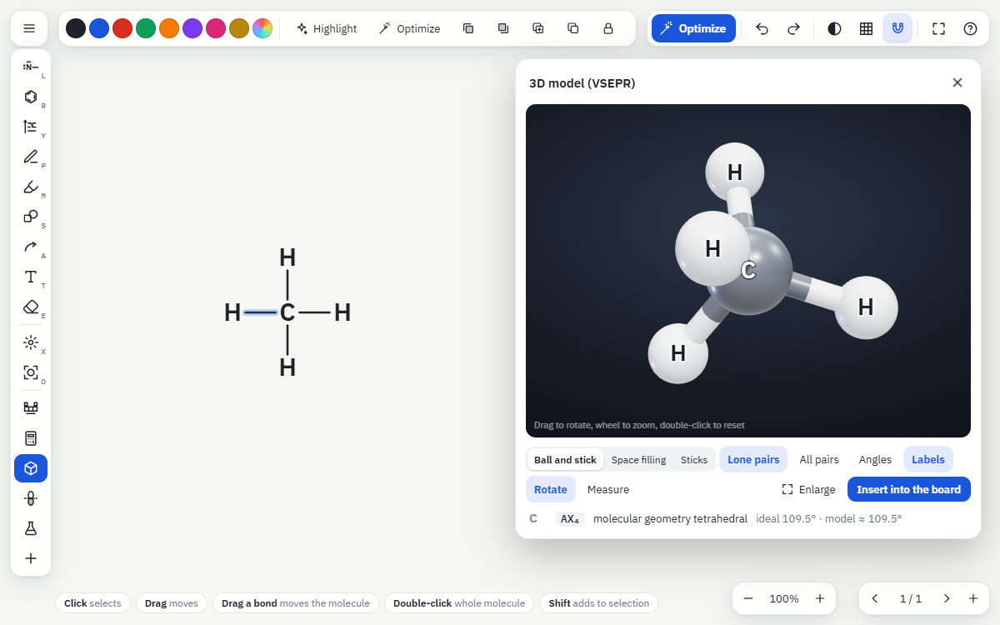

# ChemBoard

**Lousa interativa para desenhar e apresentar química em aula.**

Use a caneta de Lewis para construir uma estrutura diante da turma, abra um modelo molecular em 3D para discutir geometria ou avance por uma aula preparada, um painel de cada vez.

**[Abrir ChemBoard ↗](https://henriquecsj.github.io/chemboard/)** · [Aulas de exemplo](#aulas-de-exemplo) · [English README](../README.md)

<picture>
  <source media="(prefers-reduced-motion: reduce)" srcset="media/reaction-playback-poster.webp">
  
</picture>

*Um passo no painel de combustão do metano. [Reproduzir a gravação com controles](https://henriquecsj.github.io/chemboard/docs/media/reaction-playback.mp4).*

## Comece com uma estrutura de Lewis

1. Abra o ChemBoard, escolha **Português (Brasil)** e clique em **Começar com o quadro vazio**.
2. Pressione **L** para ativar a caneta química. Escolha **O** na barra e clique no quadro para colocar o oxigênio.
3. Escolha **H** e arraste duas vezes a partir do oxigênio para formar as ligações O–H. Clique em dois pontos distintos ao lado do oxigênio para colocar os pares isolados.

<picture>
  <source media="(prefers-reduced-motion: reduce)" srcset="media/lewis-pen-poster.webp">
  
</picture>

*[Reproduzir a gravação da caneta de Lewis com controles](https://henriquecsj.github.io/chemboard/docs/media/lewis-pen.mp4).*

## Desenhe e gire no quadro

- **Rotação.** Selecione uma molécula, desenho, texto, imagem ou vídeo. Use **−90°**, **+90°** ou **Girar…** para indicar o ângulo exato. Arraste a alça circular em passos de 1° e mantenha **Shift** pressionado para usar passos de 15°. **Esc** cancela o arraste.
- **Traço livre.** Na **Caneta**, ative **Suavizar** para reduzir oscilações. Em **Formas**, escolha **Segurar** e faça uma breve pausa no fim do traço ou escolha **Auto** para converter formas reconhecidas ao soltar. Use **Desligado** para escrever livremente.
- **Formas prontas.** Pressione **S**, escolha uma forma e mantenha **Shift** pressionado enquanto arrasta para obter um círculo, quadrado ou triângulo equilátero. Use **Proporção fixa** em uma tela sensível ao toque.

## Da estrutura ao modelo

- **Geometria molecular.** Pressione **K** para abrir **Modelos e gerador de Lewis** e inserir **CH₄**. Com a molécula selecionada, pressione **D** para abrir o modelo 3D. Gire a molécula e compare as representações ou meça ângulos.
- **Orbitais.** Pressione **W** para abrir **Orbitais atômicos**. Varie os números quânticos, compare a superfície, a nuvem, o corte 2D e o gráfico radial, e use os controles de eixos e nós.

## Monte um diagrama de orbitais moleculares

Pressione **Y**, clique em uma área vazia e ajuste a degenerescência e o tipo em **Próximo nível**. Clique em uma coluna para colocar o nível. Para alterar um nível já desenhado, dê um duplo clique nele ou selecione-o e escolha **Editar nível**.

Use matemática em linha como `$\frac{\Delta_o}{2}$` junto ao texto de rótulos, títulos de coluna, cotas e eixos. O editor tem prévia e botões para negrito, itálico, sublinhado, frações e raízes.

## Escreva e formate texto no quadro

Pressione **T** e clique onde o texto deve ficar. O editor mostra uma prévia de textos com várias linhas, fórmulas químicas como H₂O e LaTeX em linha como `$\frac{\Delta E}{RT}$`. Selecione um trecho para aplicar negrito, itálico, sublinhado ou índices. Escolha **Modo equação** para escrever o bloco inteiro em notação matemática.

Use **Aplicar** ou **Ctrl/⌘ + Enter** para confirmar a edição. Clicar no quadro também aplica a edição. Pressione **Esc** ou escolha **Cancelar** para descartar a edição.

## Aulas de exemplo

Abra **Menu → Aulas prontas** e escolha uma aula. As páginas entram depois da página atual e ficam editáveis.

| Aula | Experimente | Quadro editável |
| --- | --- | --- |
| **Animações: exemplos** · 8 páginas | Vá à página de reações e, com a ferramenta Mão, dê um duplo clique no painel de combustão do metano. Pressione **→** para começar e avance dos reagentes aos produtos. | [Baixar JSON](https://henriquecsj.github.io/chemboard/examples/animation-examples.json) · [Vista geral da página de reações](images/reaction-lesson.png) |
| **Interações intermoleculares** · 9 páginas | Compare os modelos de sólido, líquido e gás e avance para os exemplos de cada interação. | [Baixar JSON](https://henriquecsj.github.io/chemboard/examples/intermolecular-interactions.json) |

Para importar um JSON, salve o arquivo e escolha **Menu → Abrir quadro**. Se já houver conteúdo, você pode adicionar as páginas ou substituir o quadro.

## Prepare e apresente sua aula

- Use **+** ao lado do contador para criar páginas. Enquadre um painel, clique com o botão direito em uma área vazia e escolha **Guardar esta vista como parada**.
- Use **→ / ←** para percorrer as paradas e os passos. A barra de apresentação permite recomeçar, pausar e alterar a velocidade. Pressione **Esc** para voltar ao quadro completo.
- Pressione **F** para tela cheia ou **U** para ocultar a interface. Use **X** para o laser ou **O** para o holofote.
- Clique com o botão direito e escolha **Travar** para proteger um objeto. Use **Destravar** quando quiser editá-lo de novo.
- Use **Salvar quadro (.json)** para guardar uma cópia editável ou **Exportar imagem (PNG)** para usar a página em outro material.

## Uso local e licença

Abra [`index.html`](../index.html) em um navegador de computador. A caneta e as aulas embutidas funcionam a partir do HTML local. A busca online de moléculas, as mídias remotas e as fontes web usam a internet. Os visualizadores 3D precisam de WebGL. O navegador salva o quadro no endereço usado para abri-lo. Exporte JSON para fazer backup ou trocar de computador.

[Apache 2.0](../LICENSE). O Three.js incorporado usa a licença MIT, incluída em `index.html`. [Relatar um problema](https://github.com/HenriqueCSJ/chemboard/issues/new)
