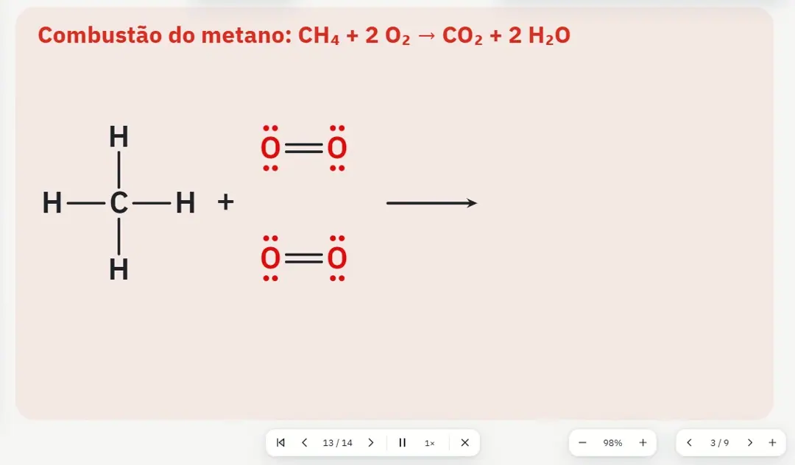
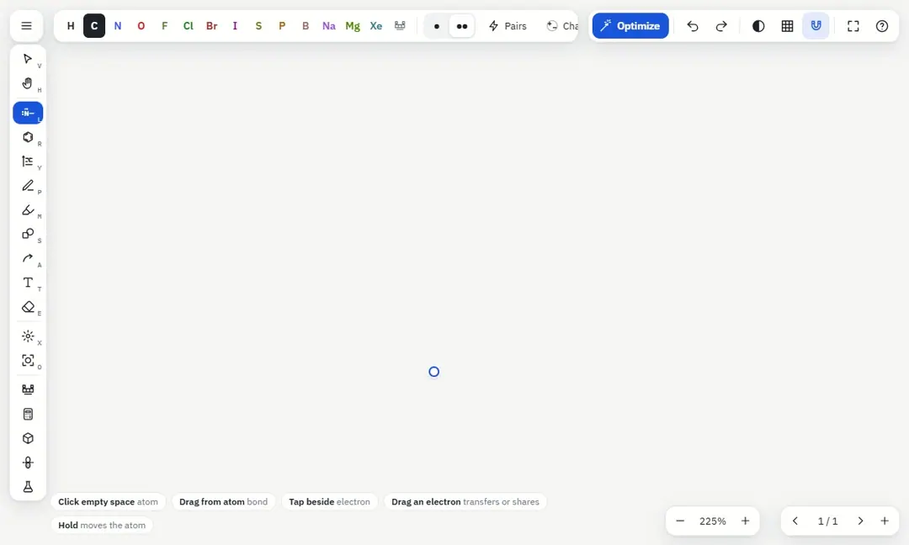
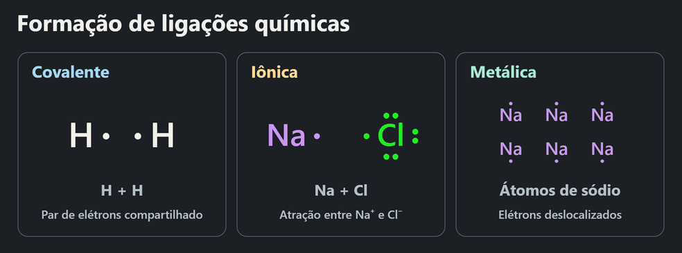
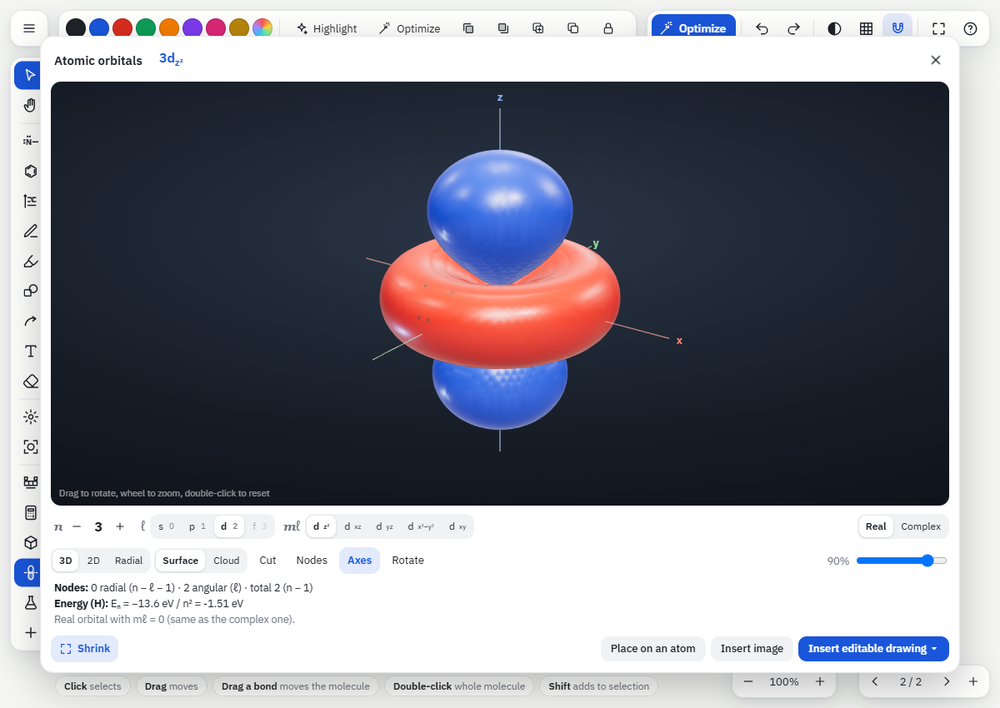
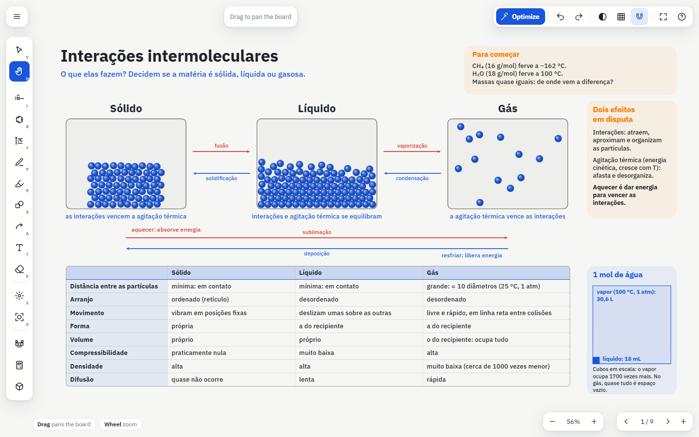

# ChemBoard

**Lousa interativa para desenhar e apresentar química em aula.**

Use a caneta de Lewis para construir uma estrutura diante da turma, abra um modelo molecular em 3D para discutir geometria ou avance por uma aula preparada, um painel de cada vez.

**[Abrir ChemBoard ↗](https://henriquecsj.github.io/chemboard/)** · [Aulas de exemplo](#aulas-de-exemplo) · [IC677](#aulas-de-ic677) · [English README](../README.md)

<picture>
  <source media="(prefers-reduced-motion: reduce)" srcset="media/reaction-playback-poster.webp">
  
</picture>

*Um passo no painel de combustão do metano. [Reproduzir a gravação com controles](https://henriquecsj.github.io/chemboard/docs/media/reaction-playback.mp4).*

## Comece com uma estrutura de Lewis

1. Abra o ChemBoard, escolha **Português (Brasil)** e clique em **Começar com o quadro vazio**.
2. Pressione **L** para ativar a caneta química. Escolha **O** na barra e clique no quadro para colocar o oxigênio.
3. Escolha **H** e arraste duas vezes a partir do oxigênio para formar as ligações O–H. Clique em dois pontos distintos ao lado do oxigênio para colocar os pares isolados.

<picture>
  <source media="(prefers-reduced-motion: reduce)" srcset="media/lewis-pen-poster.webp">
  
</picture>

*[Reproduzir a gravação da caneta de Lewis com controles](https://henriquecsj.github.io/chemboard/docs/media/lewis-pen.mp4).*

Com **Selecionar e mover** ou a **Caneta química**, arraste o rótulo de uma carga formal ou parcial para reposicioná-lo. O rótulo acompanha o átomo ao mover ou girar a estrutura. Dê um duplo clique no rótulo para restaurar o posicionamento automático.

Com **Selecionar e mover**, arraste um par isolado ao redor de seu átomo. Na **Caneta química**, segure **Shift** antes de começar a arrastar o par para apenas reposicioná-lo. Use **Desfazer** para reverter o ajuste.

## Formação de ligações

<picture>
  <source media="(prefers-reduced-motion: reduce)" srcset="media/bond-formation-poster.png">
  
</picture>

*No H₂, o traço representa o par de elétrons compartilhado. No modelo iônico, a transferência de elétron completa o octeto do cloro e, em seguida, os íons Na⁺ e Cl⁻ se atraem. No sódio sólido, os elétrons de valência ficam deslocalizados entre os cátions.*

## Desenhe cadeias carbônicas e adicione hidrogênios

- Pressione **Z** e arraste no quadro. A prévia mostra o zigue-zague e a contagem de carbonos antes de soltar. Segure **Shift** para orientar a cadeia em passos de 15°. Arraste a partir de um carbono com valência livre para estender a estrutura ou use **Inserir por número…** para montar uma cadeia de 2 a 80 carbonos. As novas cadeias começam em fórmula de esqueleto.
- Clique em **Completar H** para acrescentar os hidrogênios que faltam à seleção e manter as ordens de ligação. A cadeia nova já fica selecionada. Em uma molécula existente, use **Selecionar e mover** e dê um duplo clique em um átomo ou ligação para selecionar a molécula inteira.
- Para ilustrar a hidrogenação, selecione uma ligação C=C ou C≡C ou seus dois carbonos. **Hidrogenar C=C/C≡C** converte as ligações não aromáticas elegíveis em simples e completa os H nesses carbonos. A operação pode ser revertida em um único **Desfazer**.

## Desenhe e gire no quadro

- **Rotação.** Selecione um átomo para girar a molécula inteira. Você também pode girar desenhos, textos, imagens e vídeos, individualmente ou em grupo. Use **−90°**, **+90°** ou **Girar…** para indicar o ângulo exato. Arraste a alça circular em passos de 1° e mantenha **Shift** pressionado para usar passos de 15°. **Esc** cancela o arraste.
- **Traço livre.** Na **Caneta**, ative **Suavizar** para reduzir oscilações. Em **Formas**, escolha **Segurar** e faça uma breve pausa no fim do traço ou escolha **Auto** para converter formas reconhecidas ao soltar. Use **Desligado** para escrever livremente.
- **Formas prontas.** Pressione **S**, escolha uma forma e mantenha **Shift** pressionado enquanto arrasta para obter um círculo, quadrado ou triângulo equilátero. Use **Proporção fixa** em uma tela sensível ao toque.

## Compare elementos na lousa

Abra a tabela com **Tab**, escolha **EN**, **Raio** ou **EI** e marque os elementos que quer comparar. **Só o recorte no quadro** leva as células com os valores da propriedade escolhida. A inserção da tabela inteira também leva os valores. Um travessão indica dado indisponível.

Na lousa, clique com o botão direito sobre um elemento para destacá-lo ou separá-lo do recorte como uma peça que você pode mover sozinha. Na tabela inteira, essa opção cria uma cópia. Em tela sensível ao toque, selecione a tabela e abra **Elementos da tabela…** para fazer essas edições ou trocar a propriedade exibida.

## Da estrutura ao modelo

- **Geometria molecular.** Pressione **K** para abrir **Modelos e gerador de Lewis** e inserir **CH₄**. Com a molécula selecionada, pressione **D** para abrir o modelo 3D. Gire a molécula e compare as representações ou meça ângulos. Clique em **Inserir modelo 3D** para levar um modelo manipulável à lousa. Arraste-o com a ferramenta Mão durante a aula ou use seu nome para aplicar operações de simetria em um roteiro. [Exemplos de roteiro 3D](scenes.md#spatial-drawings-and-matrices)
- **Orbitais.** Pressione **W** para abrir **Orbitais atômicos**. Varie os números quânticos, compare a superfície, a nuvem, o corte 2D e o gráfico radial, e use os controles de eixos e nós.




## Monte um diagrama de orbitais moleculares

Pressione **Y**, clique em uma área vazia e ajuste a degenerescência e o tipo em **Próximo nível**. Clique em uma coluna para colocar o nível. Para alterar um nível já desenhado, dê um duplo clique nele ou selecione-o e escolha **Editar nível**.

Use matemática em linha como `$\frac{\Delta_o}{2}$` junto ao texto de rótulos, títulos de coluna, cotas e eixos. O editor tem prévia e botões para negrito, itálico, sublinhado, frações e raízes.

## Escreva e formate texto no quadro

Pressione **T** e clique onde o texto deve ficar. O editor mostra uma prévia de textos com várias linhas, fórmulas químicas como H₂O e LaTeX em linha como `$\frac{\Delta E}{RT}$`. Selecione um trecho para aplicar negrito, itálico, sublinhado ou índices. Escolha **Modo equação** para escrever o bloco inteiro em notação matemática.

Use **Aplicar** ou **Ctrl/⌘ + Enter** para confirmar a edição. Clicar no quadro também aplica a edição. Pressione **Esc** ou escolha **Cancelar** para descartar a edição.

## Conecte um assistente de IA

Pressione **J** para abrir o assistente. O conector local serve ao ChatGPT via Secure MCP Tunnel e a clientes MCP como Claude Desktop, Claude Code e Codex. Para pedir desenhos na própria lousa, configure uma API OpenAI, Anthropic ou compatível com ferramentas, como Gemini ou Ollama. [Guia do conector](../connectors/README.md#resumo-em-português)

## Aulas de exemplo

Abra **Menu → Aulas prontas** e escolha uma aula. As páginas entram depois da página atual e ficam editáveis. Na ficha de uma aula, abra **Atividades complementares** para inserir uma demonstração curta ou uma sequência de exercícios.

| Aula | Experimente | Quadro editável |
| --- | --- | --- |
| **Animações: exemplos** · 8 páginas | Vá à página de reações e, com a ferramenta Mão, dê um duplo clique no painel de combustão do metano. Pressione **→** para começar e avance dos reagentes aos produtos. | [Baixar JSON](https://henriquecsj.github.io/chemboard/examples/animation-examples.json) · [Vista geral da página de reações](images/reaction-lesson.png) |
| **Interações intermoleculares** · 9 páginas | Compare os modelos de sólido, líquido e gás e avance para os exemplos de cada interação. | [Baixar JSON](https://henriquecsj.github.io/chemboard/examples/intermolecular-interactions.json) |
| **O risco a lápis · Bohr–Rydberg** · 7 cenas | Investigue por que a marca de 550 nm cai entre duas linhas de Balmer. A atividade complementar inclui um gráfico interativo da série e problemas resolvidos de energia do fóton e deposição de cobre. | [Roteiro](../examples/bohr-rydberg.chemboard) · **Aulas prontas** |
| **Cenas: exemplos** · 5 páginas | Acompanhe a transformação da equação de Arrhenius, o traçado de uma reação ácido–base de Lewis e um gráfico de Maxwell–Boltzmann cujos valores respondem ao controle deslizante. | [Baixar JSON](../examples/scene-examples.json) |



Para importar um JSON, salve o arquivo e escolha **Menu → Abrir quadro**. Se já houver conteúdo, você pode adicionar as páginas ou substituir o quadro.

### Aulas de IC677

Abra **Menu → Aulas prontas** para inserir uma cópia editável. Ao apresentar a aula completa de simetria, use **Menu → Capítulos da aula…** para saltar para um tema. Avance e volte pelos passos com **PgDn** e **PgUp**. Use a ferramenta Mão para girar as estruturas 3D e as redes.

| Aula | O que explorar | Arquivos |
| --- | --- | --- |
| **Simetria molecular** · 48 cenas e 225 passos | Identifique elementos e grupos pontuais, depois passe por matrizes e tabelas de caracteres até chegar a espectroscopia e modos vibracionais. A atividade complementar detalha as operações de simetria da água e suas matrizes. | [Quadro JSON](https://henriquecsj.github.io/chemboard/examples/ic677-simetria-molecular.json) · [Roteiro](../examples/ic677-simetria-molecular.chemboard) · [Roteiro da atividade com água](../examples/ic677-simetria-agua.chemboard) |
| **Estado sólido** · 15 cenas e 71 passos | Construa células unitárias a partir de padrões que se repetem, compare as redes de Bravais e explore empacotamento, interstícios e estruturas cristalinas. A atividade complementar compara as três células cúbicas lado a lado. | [Quadro JSON](https://henriquecsj.github.io/chemboard/examples/ic677-estado-solido.json) · [Roteiro](../examples/ic677-estado-solido.chemboard) · [Roteiro da atividade com células cúbicas](../examples/ic677-celulas-cubicas.chemboard) |

Abra um quadro JSON em **Menu → Abrir quadro…**. Para ler ou editar um arquivo `.chemboard`, use **Menu → Roteiro de animação… → Abrir arquivo…**.

## Prepare e apresente sua aula

- Use **+** ao lado do contador para criar páginas. Enquadre um painel, clique com o botão direito em uma área vazia e escolha **Guardar esta vista como parada**.
- Use **→ / ←** para percorrer as paradas e os passos. A barra de apresentação permite recomeçar, pausar e alterar a velocidade. Pressione **Esc** para voltar ao quadro completo.
- Pressione **F** para tela cheia ou **U** para ocultar a interface. Use **X** para o laser ou **O** para o holofote.
- Clique com o botão direito e escolha **Travar** para proteger um objeto. Use **Destravar** quando quiser editá-lo de novo.
- Use **Salvar quadro (.json)** para guardar as páginas, os passos e as animações em um arquivo. Marque **Incluir roteiros editáveis** para levar também o texto dos roteiros. **Exportar imagem (PNG)** captura a página atual.

Para mover uma fórmula ou forma durante a aula, selecione a posição inicial e depois a final. Clique com o botão direito em um dos objetos e escolha **Mover entre passos…**. Em duas fórmulas, clique no termo de origem e no correspondente de destino nas prévias. Na apresentação, **→** ou **PgDn** aciona o movimento no passo escolhido.

### Roteiro da página

Use **Menu → Roteiro da página…** para escrever efeitos em português ou inglês. Você pode nomear um desenho no menu de contexto, posicionar objetos uns em relação aos outros, transformar formas, animar números e vinculá-los a gráficos. **Aplicar** registra uma edição que pode ser desfeita com **Ctrl+Z**, incluindo os objetos, o roteiro e o enquadramento. Durante a apresentação, a caneta e o marca-texto anotam apenas o passo atual. Use a barra de passos para limpar essas anotações durante a sessão. [Referência de comandos](scenes.md)

### Roteiro de animação

Abra **Menu → Roteiro de animação…** para criar uma aula do zero. Cada `cena` define uma página de 2400 × 1350 unidades, com origem no canto superior esquerdo. Declare o fundo, os textos, as fórmulas e o diagrama antes do primeiro `passo`. Cada passo espera **→** ou **PgDn**. Use **←** ou **PgUp** para voltar. As ações começam juntas, exceto quando uma usa `depois` para aguardar alguns milissegundos.

```text
cena "Energia do fóton" fundo #101c30
texto titulo 140 140 88 #f5f7fc "Energia do fóton" negrito
formula energia 140 420 110 #f5f7fc "E=h\\nu" oculto
linha marca 140 650 950 650 8 #ff847d oculto

passo "Apresentar a relação"
  mostrar energia
  traçar marca 950
```

Desenhe com `linha`, `seta`, `retangulo`, `circulo` ou `caminho`. Escreva textos e LaTeX entre aspas no formato JSON, duplicando cada barra invertida do LaTeX. Use `oculto` para que um objeto comece invisível. `mostrar` e `ocultar` controlam a visibilidade. `traçar` desenha progressivamente. `mover`, `girar` e `transformar` animam objetos compatíveis. Em fórmulas, use o mesmo identificador em `\\term{id}{…}` para acompanhar um termo entre expressões.

Para levar um objeto à página seguinte, use o mesmo nome nas duas cenas e inclua `transicao 1600 eixo marcador` na cena de destino, antes do primeiro `passo`. Cada objeto listado deve estar visível no fim da cena anterior e na abertura da próxima. O avanço anima a passagem em 1600 ms. A tecla de retorno refaz o caminho ao contrário. Use formas compatíveis, caminhos com a mesma contagem de pontos, rótulos de texto iguais ou fórmulas LaTeX com termos associados.

Acrescente `roteiro pagina` logo após `cena` para usar os efeitos do roteiro de página dentro de uma aula com transições entre cenas. [Exemplo combinado](scenes.md#combine-page-scripts-and-scene-transitions)

**Abrir arquivo…** carrega um roteiro. **Compilar em novas páginas** insere uma cópia editável após a página atual. **Salvar roteiro** exporta um arquivo `.chemboard`. Consulte o [roteiro completo de Bohr–Rydberg](../examples/bohr-rydberg.chemboard) para ver várias cenas em sequência. Para animar uma forma que já está no quadro, selecione-a antes de abrir o editor.

## Uso local e licença

Abra [`index.html`](../index.html) em um navegador de computador. A caneta e as aulas embutidas funcionam a partir do HTML local. A busca online de moléculas, as mídias remotas e as fontes web usam a internet. O renderizador das aulas espaciais usa WebGL quando disponível e tem uma alternativa em Canvas. O navegador salva o quadro no endereço usado para abri-lo. Exporte JSON para fazer backup ou trocar de computador.

[Apache 2.0](../LICENSE). O Three.js incorporado usa a licença MIT, incluída em `index.html`. [Relatar um problema](https://github.com/HenriqueCSJ/chemboard/issues/new)
